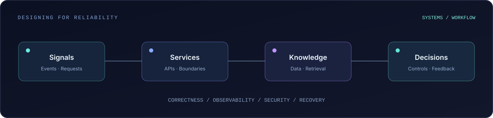

 

**Backend Engineering** &nbsp;·&nbsp; **Distributed Systems** &nbsp;·&nbsp; **Agentic AI**

Software Engineering @ ENSIAS &nbsp; | &nbsp; 1337 Coding School (42 Network) &nbsp; | &nbsp; Rabat, Morocco

  

 

### 01 / The engineer behind the code

I am a software engineering student working at the intersection of **backend architecture, reliable systems, and applied AI**. I enjoy reasoning about *why* an architecture works: failure modes, boundaries, data consistency, observability, and the trade-offs behind each engineering decision.

I build with **Java, Python, TypeScript, Spring Boot, and FastAPI**, and I'm exploring the engineering foundations of distributed and AI-assisted systems. I'm interested in well-designed software rather than complexity for its own sake.

### 02 / How I think about systems

 

### 03 / Selected work

<table>
<tr>
<td width="50%" valign="top">

**[DevPilot AI ↗](https://github.com/oussamamahidev/DevPilot-AI)**  
`AI ENGINEERING` · `WORK IN PROGRESS`

Multi-workspace document intelligence platform with a FastAPI backend, Next.js frontend, PostgreSQL, Qdrant and Docker-based developer workflow. The public repository currently documents its foundation and planned RAG capabilities.

**Focus:** service boundaries · local AI · data pipelines
</td>
<td width="50%" valign="top">

**[Maroc Affiliate AI ↗](https://github.com/oussamamahidev/Marketing)**  
`BACKEND ENGINEERING` · `WORK IN PROGRESS`

AI-assisted marketing system with a strong emphasis on trustworthy backend foundations. Current public work covers configuration, PostgreSQL integration, structured logging, health checks and quality gates.

**Focus:** explicit transactions · reliability · security
</td>
</tr>
<tr>
<td valign="top">

**[mini-rag-pro ↗](https://github.com/oussamamahidev/mini-rag-pro)**  
`RETRIEVAL AUGMENTED GENERATION`

A focused repository for exploring RAG concepts. Documentation is being developed; see the source for its current implementation.

**Focus:** retrieval · language models · experimentation
</td>
<td valign="top">

**[Terminal Portfolio ↗](https://github.com/oussamamahidev/terminalPortfolio)**  
`FRONTEND` · `NEXT.JS`

A portfolio experiment using Next.js. An opportunity to explore distinctive interaction patterns and the visual side of engineering.

**Focus:** interface design · TypeScript · web
</td>
</tr>
</table>

### 04 / Tools I work with

  

`API DESIGN` &nbsp; `DATABASES` &nbsp; `RAG` &nbsp; `DOCKER` &nbsp; `TESTING` &nbsp; `ARCHITECTURE`

### 05 / Currently exploring

- **Distributed systems:** messaging, concurrency, idempotency, resilience and data consistency.
- **AI engineering:** retrieval pipelines, multi-agent coordination, evaluation and human oversight.
- **Cloud-native engineering:** observability, containers, Kubernetes and deployment workflows.

---

GOOD SYSTEMS ARE DESIGNED FOR WHAT HAPPENS WHEN THINGS GO WRONG.

 

[**View repositories**](https://github.com/oussamamahidev?tab=repositories) &nbsp;·&nbsp; [**DevPilot AI**](https://github.com/oussamamahidev/DevPilot-AI) &nbsp;·&nbsp; [**Maroc Affiliate AI**](https://github.com/oussamamahidev/Marketing)

  

Designed for GitHub · Animated SVG · Motion respects reduced-motion preferences

