<div align="center">



<!-- No third-party banner services. Pure SVG / CSS. -->

[**VIEW THE CODE**](https://github.com/oussamamahidev?tab=repositories) &nbsp; / &nbsp; [**DEV PILOT AI**](https://github.com/oussamamahidev/DevPilot-AI) &nbsp; / &nbsp; [**MAROC AFFILIATE AI**](https://github.com/oussamamahidev/Marketing)

</div>

### `01 / whoami`

```console
oussama@engineeringEnsias:~$ cat about.md
> Software engineering student @ ENSIAS × 1337 (42 Network)
> Focus: Backend systems · AI engineering · software architecture
> Location: Rabat, Morocco
> Mindset: Understand the trade-offs. Build for failure. Keep learning.
```

I enjoy building software where **backend engineering meets intelligent systems**: clear service boundaries, well-defined APIs, reliable data handling, retrieval pipelines, and agents with human oversight. I care as much about **why a system works and how it fails** as I do about writing the code.

### `02 / sudo ./skills --professional --grouped`

<div align="center">

</div>

<details>
<summary><strong>▸ Expand the stack in searchable, accessible text</strong></summary>

| Domain | Technologies and concepts |
| --- | --- |
| **Backend & architecture** | Java, Python, Spring Boot, FastAPI, REST APIs, Microservices, DDD, OAuth2, JWT, RBAC |
| **Agentic AI & retrieval** | LLM APIs, multi-agent workflows, RAG, Qdrant, embeddings, vector search, Gemini, OpenAI APIs, evaluation |
| **Data & messaging** | PostgreSQL, MongoDB, MySQL, Redis, SQL, data modeling, Kafka concepts, idempotency |
| **Frontend** | TypeScript, JavaScript, React, Next.js, API integration, component design |
| **Platform & delivery** | Docker, Git, Linux, GitHub Actions, CI/CD, Jenkins, Kubernetes foundations |
| **Engineering practices** | Testing, code review, SOLID, design patterns, ADRs, observability, security, reliability and recovery |

**Note:** This is a working and learning stack, not a claim of production-level mastery in every listed technology.

</details>

### `03 / system-thinking --trace`

<div align="center">

</div>

> *Strong engineering is not the largest architecture diagram. It is being able to justify boundaries, protect invariants, observe failures, and recover safely.*

### `04 / ls ~/selected-work`

<div align="center">

</div>

<table>
<tr>
<td width="50%" valign="top">

**[01 / DevPilot AI](https://github.com/oussamamahidev/DevPilot-AI)**

`AI ENGINEERING` · `EVOLVING`

A document-intelligence and AI engineering workspace built around **FastAPI, Next.js, PostgreSQL**, and retrieval-oriented system design. Exploring multi-agent workflows, data pipelines and robust service boundaries.

</td>
<td width="50%" valign="top">

**[02 / Maroc Affiliate AI](https://github.com/oussamamahidev/Marketing)**

`BACKEND` · `EVOLVING`

An AI-assisted marketing workflow emphasizing **controlled actions, auditable decisions, approvals, validation and data integrity**. Python/FastAPI and PostgreSQL foundations.

</td>
</tr>
<tr>
<td valign="top">

**[03 / mini-rag-pro](https://github.com/oussamamahidev/mini-rag-pro)**

`RETRIEVAL` · `EXPERIMENTS`

Hands-on learning around **retrieval-augmented generation**, vector retrieval and experimentation with grounded language-model outputs.

</td>
<td valign="top">

**[04 / Terminal Portfolio](https://github.com/oussamamahidev/terminalPortfolio)**

`FRONTEND` · `DESIGN`

A **Next.js / TypeScript** portfolio experiment exploring the intersection of user experience, interaction design and software engineering identity.

</td>
</tr>
</table>

### `05 / cat current-interests.txt`

```yaml
learning_and_building:
  distributed_systems: [concurrency, messaging, sagas, idempotency, consistency]
  applied_ai: [RAG, agents, evaluation, human-in-the-loop]
  platform: [containers, Kubernetes, observability, CI/CD]
  engineering: [architecture, testing, security, clean design]

principle: "Build the simplest system that handles the real failure modes."
```

<div align="center">



**[Repositories](https://github.com/oussamamahidev?tab=repositories)** &nbsp; · &nbsp; **[DevPilot AI](https://github.com/oussamamahidev/DevPilot-AI)** &nbsp; · &nbsp; **[Maroc Affiliate AI](https://github.com/oussamamahidev/Marketing)**

<sub>Terminal OS × AI Command Center • self-contained animated SVG • reduced-motion friendly</sub>

</div>
